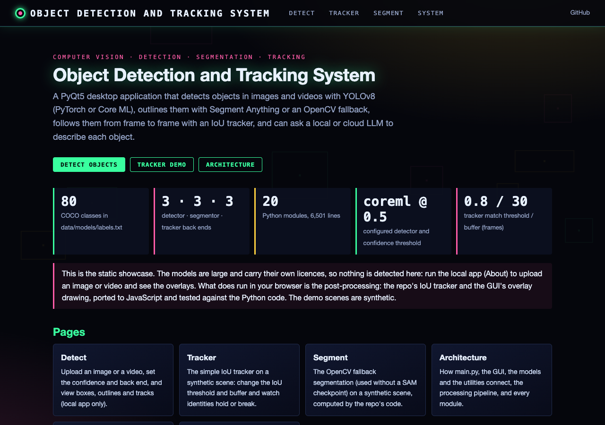
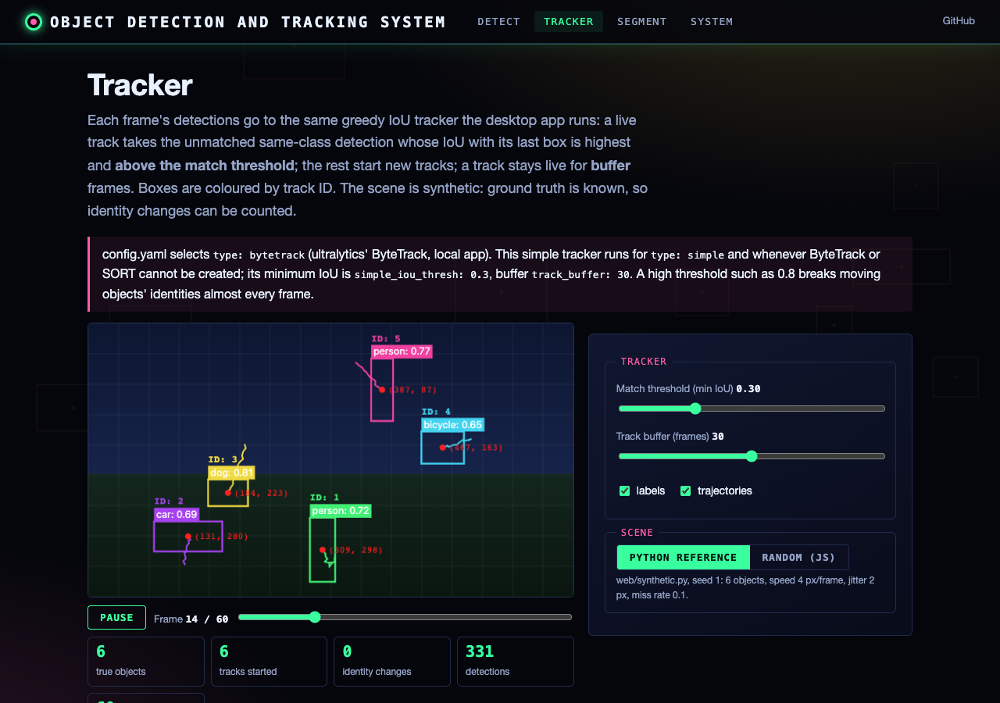
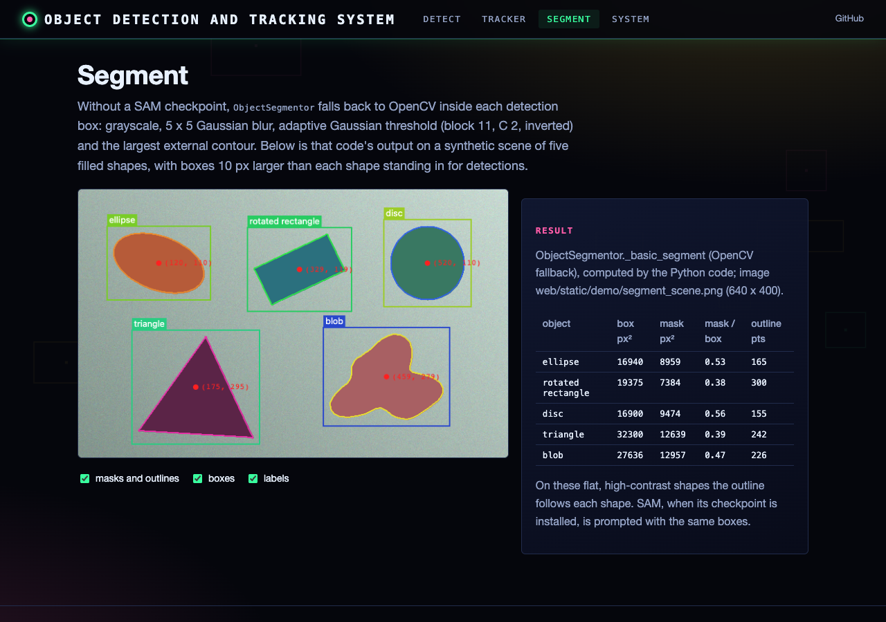
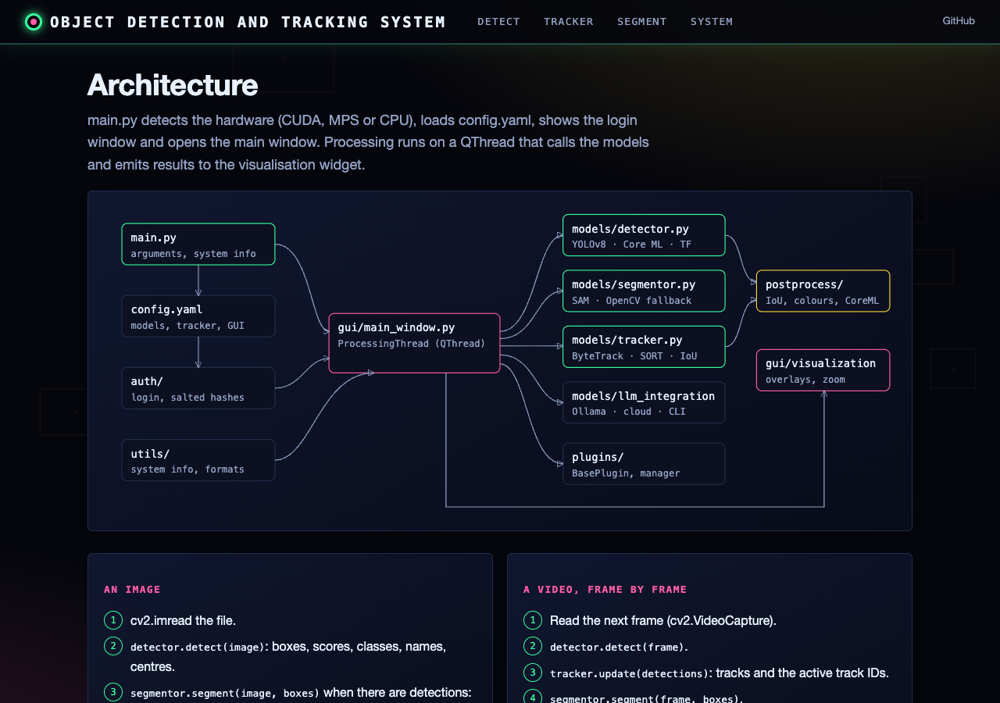
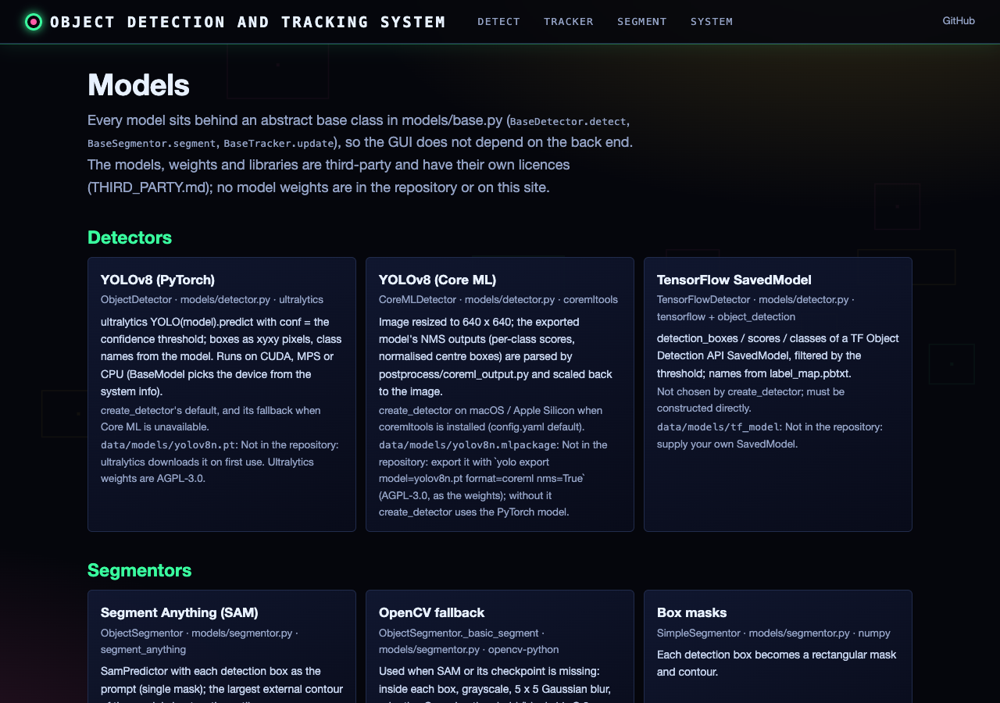

# Object Detection and Tracking System

A comprehensive computer vision application for detecting, segmenting, and tracking objects in images and videos, with optional LLM integration for enhanced object recognition.

## Features

- **Object Detection**: Identify objects in images and videos using state-of-the-art models (YOLOv8, TensorFlow, CoreML)
- **Instance Segmentation**: Generate precise object outlines using Segment Anything Model (SAM)
- **Object Tracking**: Track objects across video frames with ByteTrack (via ultralytics), SORT, or a simple IoU tracker
- **LLM Integration**: Enhanced object recognition using Ollama (local) or Cloud APIs
- **Multi-Format Support**: Process various image and video formats
- **Hardware Optimization**: Automatic detection and utilization of available hardware (CUDA, MPS on Apple Silicon)
- **User Authentication**: Secure login system with user management
- **Plugin System**: Extensible architecture through plugins
- **Rich Visualization**: Interactive display with zooming, panning, and object highlighting

## System Requirements

- Python 3.8 or higher
- PyTorch 2.0 or higher
- OpenCV 4.7 or higher
- PyQt5 5.15 or higher
- 4GB RAM minimum (8GB+ recommended)
- NVIDIA GPU with CUDA support (optional, for acceleration)
- Apple Silicon (M1/M2/M3) for MPS acceleration (optional)

## Installation

1. Clone the repository:
   ```bash
   git clone https://github.com/gddickinson/object_detection_system.git
   cd object_detection_system
   ```

2. Install dependencies:
   ```bash
   pip install -r requirements.txt
   ```

3. Models (not included in this repository; see [THIRD_PARTY.md](THIRD_PARTY.md) for their licences):

   - **YOLOv8**: nothing to do. On first use ultralytics downloads `yolov8n.pt` into `data/models/`. The Ultralytics
     YOLOv8 weights are licensed under **AGPL-3.0**, not this project's MIT licence.
   - **Core ML (optional, Apple Silicon)**: export the weights once (writes `data/models/yolov8n.mlpackage`):
     ```bash
     yolo export model=data/models/yolov8n.pt format=coreml nms=True
     ```
     Without it, `create_detector` uses the PyTorch model.
   - **SAM (optional)**: download the ViT-B checkpoint; without it the OpenCV fallback segments.
     ```bash
     wget -O data/models/sam_vit_b_01ec64.pth https://dl.fbaipublicfiles.com/segment_anything/sam_vit_b_01ec64.pth
     ```

## Usage

### Starting the Application

Run the main application:

```bash
python main.py
```

With options:
```bash
# Skip login screen (development only)
python main.py --skip-login

# Specify input file
python main.py --input /path/to/image.jpg

# Debug mode
python main.py --debug
```

### Login

- Default admin credentials:
  - Username: `admin`
  - Password: `admin`
- After first login, navigate to User Management to change the admin password and/or create new users.

### Basic Workflow

1. Select an input image or video using the "Select Input" button or File → Open Input
2. Choose detection model and adjust confidence threshold
3. Enable/disable LLM integration (Ollama, Cloud API)
4. Click "Process" to analyze the input
5. View results in the visualization area
6. Save results using File → Save Results

### Ollama Integration

To use Ollama for LLM analysis:

1. Install Ollama from [ollama.ai](https://ollama.ai)
2. Pull the Llama3 model (or another model of your choice):
   ```bash
   ollama pull llama3
   ```
3. Start the Ollama service:
   ```bash
   ollama serve
   ```
4. In the application, select "Ollama" in the LLM dropdown

## Configuration

The application settings can be configured through the GUI (Edit → Settings) or by editing the `config.yaml` file.

Key configuration options:

- **Models**: Select and configure detection, segmentation, and tracking models
- **LLM Integration**: Configure Ollama, Cloud API, or command-line LLM integration
- **System**: Configure hardware acceleration, memory usage, and logging
- **GUI**: Adjust window size, theme, and other interface settings
- **Processing**: Configure batch size, output directory, and other processing options

Note on tracking: `type: bytetrack` uses ultralytics' BYTETracker (`models/bytetrack_adapter.py`; `track_thresh`,
`track_buffer` and `match_thresh` are its settings) and `type: sort` the separate `sort` package. For `type: simple`, or
when neither can be created, the built-in IoU tracker (`postprocess/iou_tracker.py`) runs, with `simple_iou_thresh`
(default 0.3) as the minimum IoU between a track's last box and a new detection.

## Project Structure

```
object_detection_system/
├── main.py                      # Entry point
├── requirements.txt             # Dependencies
├── config.yaml                  # Configuration
├── README.md                    # Documentation
├── auth/                        # Authentication
│   ├── login.py                 # Login window
│   └── user_manager.py          # User authentication
├── models/                      # AI Models
│   ├── base.py                  # Base classes
│   ├── detector.py              # Object detection
│   ├── segmentor.py             # Instance segmentation
│   ├── tracker.py               # Object tracking
│   └── llm_integration.py       # LLM integration
├── utils/                       # Utilities
│   ├── preprocessing.py         # Preprocessing
│   ├── visualization.py         # Visualization
│   ├── system_info.py           # System detection
│   └── format_converter.py      # Format handling
├── gui/                         # User Interface
│   ├── main_window.py           # Main window
│   ├── visualization.py         # Visualization
│   └── settings_dialog.py       # Settings
├── plugins/                     # Plugin system
│   └── plugin_manager.py        # Plugin manager
└── data/                        # Data files
    ├── models/                  # Model weights
    ├── users/                   # User data
    └── examples/                # Example files
```

## Web interface

A browser front end to the same Python models, plus a static showcase site
(https://gddickinson.github.io/object_detection_system/ once GitHub Pages is enabled).

### Run the web app

```bash
pip install -r requirements.txt -r requirements-web.txt
python run_web.py          # http://127.0.0.1:8171 (local only)
```

- **Detect** (local app only): upload an image or video, or use `data/examples/cats.jpeg`; choose the confidence
  threshold and back end (`auto` = `create_detector`, Core ML or YOLOv8). The repo's detector, segmentor (SAM or the
  OpenCV fallback) and, for videos, tracker run on your computer; the page draws the GUI's overlays and downloads the
  results JSON in the desktop app's format. LLM descriptions are not offered.
- **Tracker**: the simple IoU tracker on synthetic scenes, run in the browser by a JS port that
  `web/static/track_engine.test.mjs` checks against the Python code (`tests/fixtures/tracker_cases.json`).
- **Segment**: the OpenCV fallback segmentation on a synthetic scene, precomputed by `scripts/make_segment_demo.py`.
- **Architecture** and **Models**: modules, pipeline, back ends, config.yaml and the 80 classes, read from the repo.

The static site runs no models (they are large and have their own licences) and publishes no model weights; its demo
scenes are synthetic. Build it with `python scripts/build_static.py` (output in `site/`); tests:
`python -m pytest tests` and `node web/static/track_engine.test.mjs`.

| Home | Tracker | Segment |
|---|---|---|
|  |  |  |
| **Architecture** | **Models** | |
|  |  | |

## Adding Plugins

The application supports plugins for extending functionality. To create a plugin:

1. Create a new Python file in the `plugins` directory
2. Implement the `BasePlugin` interface
3. The plugin will be automatically loaded when the application starts

Example plugin:

```python
from models.base import BasePlugin

class MyPlugin(BasePlugin):
    def get_info(self):
        return {
            'id': 'my_plugin',
            'name': 'My Plugin',
            'description': 'This is an example plugin',
            'version': '1.0',
            'author': 'Your Name',
            'type': 'processor'
        }
    
    def process(self, data):
        # Process data
        return processed_data
```

## License

This project is licensed under the MIT License - see the LICENSE file for details. Model weights and third-party
libraries keep their own licences (YOLOv8 weights: AGPL-3.0); see [THIRD_PARTY.md](THIRD_PARTY.md).

## Acknowledgements

- [Ultralytics](https://github.com/ultralytics/ultralytics) for YOLOv8
- [Segment Anything](https://github.com/facebookresearch/segment-anything) for SAM
- [ByteTrack](https://github.com/ifzhang/ByteTrack) for object tracking
- [Ollama](https://ollama.ai) for local LLM capabilities


---
*Built with AI assistance from [Claude (Anthropic)](https://claude.com/).*
